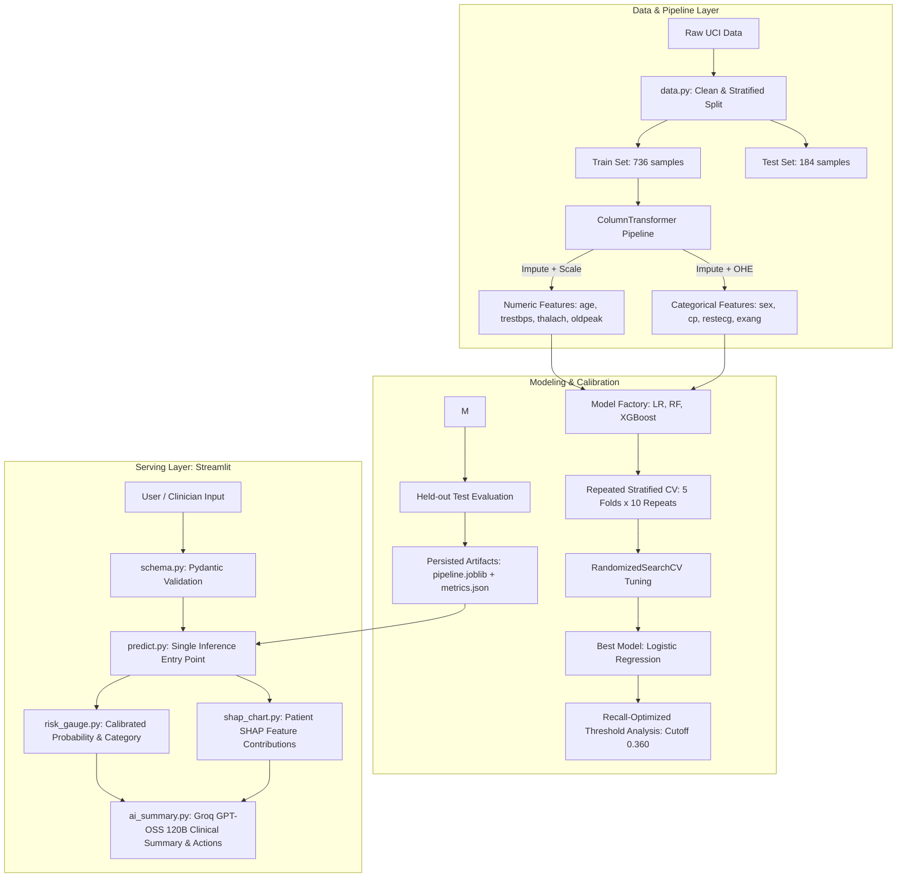

# हृदय (Heart Disease Risk Predictor)

[](https://github.com/kiyo/heart-disease-ml/actions)
[](https://www.python.org/downloads/)
[](https://github.com/astral-sh/ruff)
[](https://mypy-lang.org/)

A production-quality machine learning system for predicting the presence of heart disease from clinical features, packaged as an immutable, leak-free scikit-learn `Pipeline`, calibrated for risk probabilities, and served through an interactive Streamlit dashboard with local SHAP feature explanations.

---

## 1. Problem Statement

Coronary artery disease is one of the leading causes of morbidity and mortality worldwide. Early risk stratification allows clinicians to prioritize diagnostic workups and preventive interventions.

This project formulates heart disease risk assessment as a supervised binary classification problem:
- **Input:** 8 standardized clinical measurements (demographics, resting hemodynamics, ECG findings, and treadmill exercise stress response: `age`, `trestbps`, `thalach`, `oldpeak`, `sex`, `cp`, `restecg`, `exang`). Diagnostic features with heavy missingness, institutional zero-fill artifacts, and optimistic imputation bias (`ca`, `thal`, `slope`, `chol`, `fbs`) were ablated and omitted via variance-aware cross-validation. Optional bedside inputs (`chol`, `fbs`) remain supported in data schemas and interfaces.
- **Target:** Presence of heart disease (`0` = healthy / <50% diameter stenosis; `1` = presence of heart disease / ≥50% diameter stenosis).
- **Clinical Priority:** **High Recall (Sensitivity)**. In a clinical diagnostic assistance setting, a False Negative (missing a diseased patient) is considerably more dangerous than a False Positive (prompting follow-up confirmation). Therefore, the modeling process optimizes decision thresholds specifically for high recall (≥0.90 target) while calibrating probabilities for meaningful risk communication.

---

## 2. Dataset & Data Cleaning Notes

- **Source & Citations:**
  - **Dataset:** UCI Machine Learning Repository [Heart Disease Dataset (ID 45)](https://archive.ics.uci.edu/dataset/45/heart+disease), mirrored via Kaggle [`redwankarimsony/heart-disease-data`](https://www.kaggle.com/datasets/redwankarimsony/heart-disease-data) (`heart_disease_uci.csv`).
  - **Primary Investigators & Authors:**
    - Andras Janosi, M.D. (Gottsegen Hungarian Institute of Cardiology, Budapest)
    - William Steinbrunn, M.D. (University Hospital, Zurich, Switzerland)
    - Matthias Pfisterer, M.D. (University Hospital, Basel, Switzerland)
    - Robert Detrano, M.D., Ph.D. (V.A. Medical Center, Long Beach and Cleveland Clinic Foundation)
    - Donor: David W. Aha
- **Scope & Scale:** Combines all 4 clinical cohorts (Cleveland, Hungarian, Switzerland, and Long Beach V.A.) totaling **920 patient records** and 16 raw fields.
- **Data Hardening & Ingestion Integrity:**
  - The stale, Cleveland-only 303-row cache (`data/raw/heart_disease.csv`) has been **permanently deleted**.
  - All silent fallbacks (such as `ucimlrepo` or glob matching) were removed to prevent silent cohort substitution.
  - Ingestion strictly requires `data/raw/heart_disease_uci.csv`. Upon loading, `validate_raw_data()` asserts: exactly 920 rows, exactly 4 distinct values in `dataset` (`Cleveland`, `Hungary`, `Switzerland`, `VA Long Beach`), and the presence of all required raw schema columns. If any check fails, a descriptive `ValueError` is raised immediately.
- **Normalization & Harmonization:**
  - Standardized column names (renamed `thalch` $\to$ `thalach`, dropped administrative `id` and `dataset` columns).
  - Categorical strings (`"Male"`/`"Female"`, `"typical angina"`, `"flat"`, etc.) and boolean flags (`fbs`, `exang`) mapped cleanly to the standardized clinical schema.
  - All missing values (`NaN`, zero-cholesterol, zero-blood pressure) are median-imputed for numeric features and mode-imputed for categorical features inside the leak-free scikit-learn `Pipeline`.
- **Target Binarization:** Original target `num` ranges from 0 to 4. Cleaned into binary: `0` (absence) vs `1` (presence, scores 1–4).
- **Data Hygiene:** Duplicate records removed; physiological zeros (`chol == 0`, `trestbps == 0`) converted to `np.nan` and imputed. Stratified 80/20 train/test splitting performed before any feature transformation.

### 2.1 Physiological Validity & Zero-as-Missing Rule
In clinical physiology, a total serum cholesterol level of $0\text{ mg/dL}$ (`chol == 0`) and a resting blood pressure of $0\text{ mm Hg}$ (`trestbps == 0`) are incompatible with life and represent missing clinical data or database zero-fills in historical cohorts:
- **`chol == 0`**: 172 records in the raw dataset recorded `0`, plus 30 explicit `NaN` values, yielding **202 missing values (21.96% of the 920-patient cohort)**:
  - *Cleveland ($N=304$):* 0 explicit NaN, 0 zeros $\to$ 0 missing (0.0%).
  - *Hungary ($N=293$):* 23 explicit NaN, 0 zeros $\to$ 23 missing (7.8%).
  - *Switzerland ($N=123$):* 0 explicit NaN, 123 zeros $\to$ 123 missing (100.0% zero-filled artifact).
  - *VA Long Beach ($N=200$):* 7 explicit NaN, 49 zeros $\to$ 56 missing (28.0%).
- **`trestbps == 0`**: 1 record in the raw dataset recorded `0`, plus 59 explicit `NaN` values, yielding **60 missing values (6.52%)**.

**Data Cleaning Rule (`src/heart_disease/data.py`):**
During data ingestion in `clean_data()`, any occurrence of `chol == 0` or `trestbps == 0` is converted to `np.nan`. When cholesterol is included, the pipeline imputer replaces all 202 missing values with the training split median ($239.0\text{ mg/dL}$), assigning the identical static constant to 100% of Swiss patients and 28% of VA Long Beach patients. To eliminate this non-informative constant and prevent demographic artifacts, `chol` and `fbs` were ablated in the final 8-feature production model (Ablation Set D).

### 2.2 Feature Missingness & Imputation Strategy (N = 920)
Across all 8 active production features, missingness rates and pipeline imputation strategies are as follows:

| Feature | Clinical Type | Missing Count (Raw) | Missing Rate (%) | Pipeline Imputation Strategy |
| :--- | :--- | :--- | :--- | :--- |
| `age` | Numeric | 0 | 0.00% | `SimpleImputer(strategy='median')` |
| `trestbps` | Numeric | 60 | 6.52% | `SimpleImputer(strategy='median')` |
| `thalach` | Numeric | 55 | 5.98% | `SimpleImputer(strategy='median')` |
| `oldpeak` | Numeric | 62 | 6.74% | `SimpleImputer(strategy='median')` |
| `sex` | Categorical | 0 | 0.00% | `SimpleImputer(strategy='most_frequent')` |
| `cp` | Categorical | 0 | 0.00% | `SimpleImputer(strategy='most_frequent')` |
| `restecg` | Categorical | 2 | 0.22% | `SimpleImputer(strategy='most_frequent')` |
| `exang` | Categorical | 55 | 5.98% | `SimpleImputer(strategy='most_frequent')` |

*Note on Retired Features:*
- `ca` (fluoroscopy vessels, 66.4% missing overall, 98.4% missing outside Cleveland) and `thal` (scintigraphy defect, 52.8% missing) were retired because median/mode imputation silently encodes unperformed diagnostic tests as clinically "healthy", introducing systematic optimistic bias.
- `slope` (ST slope, 33.6% missing) was retired to eliminate subjective ECG slope classification while retaining quantitative exercise hemodynamics (`thalach`, `oldpeak`, `exang`).
- `chol` (cholesterol, 22.0% missing overall, 100% missing in Switzerland) and `fbs` (fasting blood sugar, 9.8% missing overall, 61.0% missing in Switzerland) were retired following the pre-stated ablation selection rule (Set D), removing institutional zero-fill artifacts without compromising cross-validated discrimination.

---

## 3. System Architecture



### Key Architectural Tenets
1. **Zero Data Leakage:** Preprocessing (`ColumnTransformer`) is fit solely on training folds within cross-validation and pipeline steps.
2. **Unified Core Logic:** Training and Streamlit inference consume the exact same Pydantic schema (`schema.py`), feature pipelines (`features.py`), and prediction function (`predict.py`).
3. **Configuration-Driven:** All hyperparameter search spaces, random seeds, CV folds, and paths reside in `configs/config.yaml`. No magic constants.
4. **Reproducibility:** Seed pinned across Python, NumPy, scikit-learn, and XGBoost.

---

## 4. Model Selection & Experimental Results

All models were evaluated using Stratified 5-Fold Cross-Validation on the training set (736 samples, 55.3% disease prevalence) and finally evaluated on the held-out test set (184 samples, 55.4% disease prevalence).

### 4.1 Documented Model Selection Rule
The model selection decision follows a documented, variance-aware statistical rule specified in `configs/config.yaml`:
1. **Primary Metric:** Cross-validated **ROC-AUC** on tuned models evaluated via Repeated Stratified 5-Fold Cross-Validation (5 folds $\times$ 10 repeats = 50 splits).
2. **1-Fold Standard Deviation Equivalence Rule:** Candidate models must have a mean ROC-AUC within one fold standard deviation of the top model:
   $$\mu_{\text{ROC-AUC}}(m) \ge \max_k \mu_{\text{ROC-AUC}}(k) - 1.0 \times \sigma_{\text{top}}$$
   Differences smaller than one fold standard deviation are treated as statistically indistinguishable.
3. **Tie-Breaking Hierarchy:**
   - **Model simplicity (Occam's razor):** When models perform within one standard deviation of the highest score, prioritize the simpler, clinically interpretable architecture (`logistic_regression` > `random_forest` > `xgboost`).
   - **Lower fold standard deviation:** Prioritize consistency across cross-validation folds.

**Selection Outcome (50-Split Repeated CV on 8 Features):**
- **Logistic Regression** achieved mean CV ROC-AUC of **$0.8685 \pm 0.0255$**, statistically tied with **Random Forest** (**$0.8624 \pm 0.0274$**) and **XGBoost** (**$0.8631 \pm 0.0277$**).
- With a 1-fold std tolerance cutoff of $0.8685 - 0.0255 = 0.8430$, all three candidate models are statistically indistinguishable within one standard deviation.
- **Logistic Regression** is selected:
  - **Clinical Simplicity & Interpretability:** Transparent log-odds linear coefficients, robust generalization, and parsimony over complex tree ensembles when scores are within one standard deviation.
  - **Lower Fold Variance:** Lower fold standard deviation ($0.0255$) compared to tree-based alternatives ($0.0274$ and $0.0277$).
  - **High Out-of-Fold Recall:** At the chosen decision threshold of **$0.360$**, out-of-fold recall on the training set reached **$90.91\%$** (satisfying the clinical sensitivity target of $\ge 0.90$) with an out-of-fold precision of **$76.45\%$** and F1 of **$83.05\%$**.

### 4.2 Cross-Validation Performance of Tuned Models (5x10 Repeated CV, Mean ± Std)

| Model | Hyperparameters | Accuracy | Precision | Recall | F1 Score | ROC-AUC | PR-AUC | Brier Score |
| :--- | :--- | :--- | :--- | :--- | :--- | :--- | :--- | :--- |
| **Logistic Regression** (Selected) | `C=1.0, max_iter=2000, penalty=l2, solver=lbfgs` | 0.7962 ± 0.0305 | **0.8062 ± 0.0336** | 0.8356 ± 0.0468 | 0.8198 ± 0.0287 | **0.8685 ± 0.0255** | **0.8764 ± 0.0316** | **0.1453 ± 0.0152** |
| **Random Forest** | `max_depth=5, max_features=log2, min_samples_leaf=1, min_samples_split=10, n_estimators=500` | **0.7984 ± 0.0298** | 0.7963 ± 0.0317 | **0.8575 ± 0.0468** | **0.8249 ± 0.0270** | 0.8624 ± 0.0274 | 0.8617 ± 0.0345 | 0.1491 ± 0.0118 |
| **XGBoost** | `colsample_bytree=0.6, gamma=0.3, learning_rate=0.01, max_depth=3, min_child_weight=5, n_estimators=300, subsample=1.0` | 0.7967 ± 0.0301 | 0.7980 ± 0.0334 | 0.8516 ± 0.0475 | 0.8230 ± 0.0276 | 0.8631 ± 0.0277 | 0.8629 ± 0.0349 | 0.1490 ± 0.0125 |

### 4.3 Out-of-Fold Threshold Selection & Calibration
- **Threshold Optimization on Repeated CV OOF Predictions:**
  The decision threshold was determined using out-of-fold predictions averaged across 10 repeats of 5-fold cross-validation (5 folds $\times$ 10 repeats = 50 splits, each training sample's predicted probability is averaged across the 10 validation splits where it was held out), rather than a single 5-fold pass. This eliminates fold sampling noise and prevents test set data leakage.
- **Target Recall Optimization:** The threshold was tuned strictly on training out-of-fold predictions targeting sensitivity $\ge 0.90$ (`target_recall: 0.90` in `configs/config.yaml`). Among candidate cutoffs satisfying the target sensitivity, the threshold maximizing F1 was selected: **$0.360$** (yielding $90.91\%$ OOF recall, $76.45\%$ OOF precision, and $83.05\%$ OOF F1).
- **Why Threshold 0.360 Was Kept (Cross-Site Recall Headroom):**
  While a default 0.50 cutoff would lower false alarms, threshold **$0.360$** was chosen because it provides critical sensitivity headroom against distribution shifts across independent hospital systems. In Leave-One-Site-Out (LOSO) multi-center validation, operating at 0.360 achieves $\ge 89\%$ recall across 3 independent sites (Cleveland: **$92.09\%$**, Hungary: **$91.51\%$**, VA Long Beach: **$89.26\%$**) and reaches **$87.83\%$** in Switzerland (macro mean recall **$90.17\% \pm 1.98\%$**, pooled recall **$90.18\%$**). Setting a higher threshold would compromise diagnostic safety when deployed to external clinics with differing baseline risk.
- **Calibration Method Comparison:** Probability calibration was benchmarked across three options on training out-of-fold predictions:
  - `none` (Uncalibrated Logistic Regression): Brier score **0.1454**, Log Loss **0.4578**.
  - `sigmoid` (Platt Scaling): Brier score **0.1456**, Log Loss **0.4576**.
  - `isotonic` (Isotonic Regression): Brier score **0.1455**, Log Loss **0.5401**.
  Under the documented selection rule (prefer simpler uncalibrated model unless post-hoc calibration achieves $\Delta\text{Brier} > 0.005$ and $\Delta\text{LogLoss} > 0.010$), **uncalibrated Logistic Regression (`none`) was selected**: recalibration gave no measurable gain over the uncalibrated model (Brier score 0.1454 vs sigmoid 0.1456; log loss 0.4578 vs sigmoid 0.4576), while non-parametric isotonic regression overfit the small sample size ($N=736$), causing log loss to inflate significantly from $0.4578$ to $0.5401$.

### 4.4 Final Held-Out Test Set Performance (Threshold = 0.360, N = 184)
Test metrics include empirical **95% Bootstrap Confidence Intervals** generated from 1,000 resamples:

| Metric | Point Estimate | 95% Bootstrap CI (1000 resamples) | Clinical Significance |
| :--- | :--- | :--- | :--- |
| **Recall (Sensitivity)** | **93.14%** | **[88.18%, 97.85%]** | **95 of 102 heart disease cases correctly detected** |
| **Precision** | **76.00%** | **[68.75%, 83.74%]** | Controlled false alarm rate across high-sensitivity screening |
| **Specificity** | **63.41%** | **[53.01%, 75.00%]** | **52 of 82 healthy patients correctly ruled out** |
| **ROC-AUC** | **0.8931** | **[0.8476, 0.9364]** | Strong discrimination between diseased and healthy patients |
| **PR-AUC** | **0.9186** | **[0.8790, 0.9538]** | Area under precision-recall curve across operating thresholds |
| **Brier Score** | **0.1341** | **[0.1053, 0.1615]** | Well-calibrated, reliable probability estimates |
| **F1 Score** | **0.8370** | **[0.7857, 0.8924]** | Harmonic balance between sensitivity and precision |
| **Accuracy** | **79.89%** | **[73.91%, 85.88%]** | High overall diagnostic concordance |

**Test Confusion Matrix ($N=184$):**
- **True Negatives (TN):** 52 (healthy patients correctly ruled out)
- **False Positives (FP):** 30 (healthy patients flagged for confirmation follow-up)
- **False Negatives (FN):** 7 (diseased patients missed)
- **True Positives (TP):** 95 (diseased patients accurately identified)

*Methodological Note on Test Set Reuse:* In accordance with the study protocol, because the automated pre-stated feature ablation rule selected Set D (8 features), the held-out test set was re-evaluated on the selected Set D pipeline for final reporting.

### 4.5 Multi-Center Leave-One-Site-Out (LOSO) Generalization
To evaluate cross-hospital generalizability, the production 8-feature pipeline was evaluated across the 4 clinical centers using `dataset` strictly as a grouping variable (never as a feature). Switzerland is explicitly flagged as low-confidence due to extreme class imbalance:

| Site / Center | Train $N$ | Test $N$ | Positives ($N_+$) | Negatives ($N_-$) | Prevalence | Accuracy | Precision | Recall (at 0.360) | Specificity | F1 | ROC-AUC | PR-AUC | Brier Score |
| :--- | :---: | :---: | :---: | :---: | :---: | :--- | :--- | :--- | :--- | :--- | :--- | :--- | :--- |
| **Cleveland** (USA) | 616 | 304 | 139 | 165 | 45.7% | 0.7566 | 0.6702 | 0.9209 | 0.6182 | 0.7758 | 0.8675 | 0.8567 | 0.1542 |
| **Hungary** (Budapest) | 627 | 293 | 106 | 187 | 36.2% | 0.7543 | 0.6062 | 0.9151 | 0.6631 | 0.7293 | 0.8831 | 0.8334 | 0.1485 |
| **Switzerland (Low Confidence)** | 797 | 123 | 115 | 8 | 93.5% | 0.8618 | 0.9712 | 0.8783 | 0.6250 | 0.9224 | 0.7261 | 0.9711 | 0.1744 |
| **VA Long Beach** (CA) | 720 | 200 | 149 | 51 | 74.5% | 0.7450 | 0.7917 | 0.8926 | 0.3137 | 0.8391 | 0.7461 | 0.8883 | 0.1704 |
| **Macro-Average (Site Means ± Std)** | **690 (mean)** | **230 (mean)** | **127.2 (mean)** | **102.8 (mean)** | **0.625 ± 0.263** | **0.7794 ± 0.0551** | **0.7598 ± 0.1605** | **0.9017 ± 0.0198** | **0.5550 ± 0.1621** | **0.8167 ± 0.0836** | **0.8057 ± 0.0810** | **0.8874 ± 0.0602** | **0.1619 ± 0.0125** |
| **Pooled (All 920 Patients)** | **—** | **920 (total)** | **509 (total)** | **411 (total)** | **0.553** | **0.7674** | **0.7368** | **0.9018** | **0.6010** | **0.8110** | **0.8467** | **0.8658** | **0.1586** |

#### Clinical and Statistical Interpretation of LOSO Results
1. **Expected Cross-Site Performance:**
   The macro-averaged cross-center ROC-AUC is **$0.8057 \pm 0.0810$** (pooled ROC-AUC: **$0.8467$**). Across all four independent hospital systems, sensitivity at the calibrated $0.360$ threshold ranges from **$87.83\%$** (Switzerland) to **$92.09\%$** (Cleveland) with a macro mean recall of **$90.17\% \pm 1.98\%$** (pooled recall: **$90.18\%$**), providing robust and reliable cross-center sensitivity.
2. **Switzerland Low-Confidence Warning & PR-AUC Baseline:**
   With only 8 negative patients out of 123 ($93.5\%$ disease prevalence), Switzerland's specificity ($62.50\%$) and ROC-AUC ($0.7261$) cannot be reliably estimated and carry wide uncertainty. Crucially, Switzerland's baseline PR-AUC for an uninformative chance classifier equals its prevalence ($0.9350$). Thus, the observed PR-AUC ($0.9711$) reflects extreme class imbalance rather than superior predictive discrimination.
3. **Prevalence Shifts Across Referral Pathways:**
   Baseline disease prevalence shifts from $36.2\%$ in Hungary to $93.5\%$ in Switzerland (overall pooled prevalence: $55.3\%$), reflecting differing clinical referral filters. These shifts alter positive predictive value ($60.62\%$ in Hungary vs. $97.12\%$ in Switzerland) while sensitivity remains consistently high across all centers.
4. **Cross-Site Specificity & False Positive Trade-Off:**
   Operating at threshold $0.360$, specificity ranges from $31.37\%$ (VA Long Beach) to $66.31\%$ (Hungary) (macro mean: $55.50\% \pm 16.21\%$, pooled: $60.10\%$), reflecting the deliberate screening trade-off of accepting false positives to protect patient safety.

### 4.6 Feature Ablation & Sensitivity Analysis (Repeated CV + LOSO)
To evaluate the contribution of features with heavy missingness versus routine bedside clinical measures, four feature configurations were evaluated using both 50-split Repeated Stratified CV on the training cohort and Leave-One-Site-Out (LOSO). Feature subset selection was evaluated strictly on the **training split**; full-cohort (all 920 rows) LOSO results are reported as descriptive multi-center context. All imputations are performed strictly inside the pipeline; no missing-indicator features were added:
- **(A) All 13 Features:** Baseline full feature set (`age, trestbps, chol, thalach, oldpeak, ca, sex, cp, fbs, restecg, exang, slope, thal`).
- **(B) Drop `ca` & `thal` (11 Features):** Omits fluoroscopy vessel count (`ca`, 66.4% missing) and nuclear scintigraphy (`thal`, 52.8% missing).
- **(C) Drop `ca`, `thal` & `slope` (10 Features):** Omits `ca`, `thal`, and exercise ST slope (`slope`, 33.6% missing).
- **(D) Drop `ca`, `thal`, `slope`, `chol` & `fbs` (8 Features):** Further omits serum cholesterol (`chol`, 22.0% missing overall, 100% missing in Switzerland) and fasting blood sugar (`fbs`, 9.8% missing overall, 61.0% missing in Switzerland).

| Feature Set | Features | CV ROC-AUC | CV PR-AUC | CV Brier Score | CV Recall | Train LOSO ROC-AUC | Train LOSO Recall | Full LOSO ROC-AUC | Full LOSO Recall |
| :--- | :---: | :--- | :--- | :--- | :--- | :--- | :--- | :--- | :--- |
| **(A) All 13 Features** | 13 | 0.8764 ± 0.0257 | 0.8841 ± 0.0285 | 0.1398 ± 0.0159 | 0.8461 ± 0.0524 | 0.8153 ± 0.0795 | 0.9088 ± 0.0714 | 0.8037 ± 0.0807 | 0.8899 ± 0.0606 |
| **(B) Drop ca & thal** | 11 | 0.8686 ± 0.0271 | 0.8742 ± 0.0326 | 0.1441 ± 0.0161 | 0.8388 ± 0.0504 | 0.8192 ± 0.0682 | 0.9159 ± 0.0599 | 0.8113 ± 0.0755 | 0.9032 ± 0.0540 |
| **(C) Drop ca, thal & slope** | 10 | 0.8699 ± 0.0265 | 0.8746 ± 0.0333 | 0.1440 ± 0.0156 | 0.8344 ± 0.0513 | 0.8115 ± 0.0704 | 0.9136 ± 0.0465 | 0.8081 ± 0.0782 | 0.8936 ± 0.0322 |
| **(D) Drop ca, thal, slope, chol & fbs** | 8 | 0.8685 ± 0.0255 | 0.8764 ± 0.0316 | 0.1453 ± 0.0152 | 0.8356 ± 0.0468 | 0.8119 ± 0.0710 | 0.9172 ± 0.0342 | 0.8057 ± 0.0810 | 0.9017 ± 0.0198 |

#### Ablation Analysis & Selection Rule Execution
1. **CV AUC Differences are Within Fold Variance:**
   The cross-validated ROC-AUC across candidate feature sets spans from $0.8685$ to $0.8764$, a difference of only $0.0079$, which is well within one fold standard deviation ($\pm 0.0257$). Omitting features with heavy or non-random missingness does not cause a statistically measurable reduction in cross-validated discrimination.
2. **The Clinical Danger of Imputing Specialized Diagnostics:**
   Fluoroscopy vessels (`ca`, 66.4% missing) and thallium scintigraphy (`thal`, 52.8% missing) are specialized invasive/nuclear procedures. Imputing `ca` with median ($0$) and `thal` with mode ($3 = \text{normal}$) silently encodes untested patients as healthy, introducing systematic optimistic bias. Furthermore, serum cholesterol (`chol`) has 202 missing values (22.0%), including a 100% zero-fill artifact in Switzerland (123/123) and 28.0% missing in VA Long Beach; imputing them with the training median ($239.0\text{ mg/dL}$) injects an uninformative constant across entire hospital cohorts.
3. **Selection Rule & Final Decision:**
   - **Rule:** Choose the smallest feature set within 1.0 CV std of the best that is not worse on LOSO (tolerance $\le 0.01$) evaluated on the training split.
   - **CV 1-std Cutoff:** Top CV ROC-AUC is $0.8764 \pm 0.0257$ (Set A), yielding a 1-std cutoff of $0.8507$. Set D achieves $0.8685 \pm 0.0255$, well above the cutoff.
   - **Training LOSO Comparison:** Set D achieves Training LOSO ROC-AUC of $0.8119 \pm 0.0710$, which is not worse than the top Training LOSO score ($0.8192 \pm 0.0682$, $\Delta = 0.0073 \le 0.01$).
   - **Conclusion:** **Set (D) (8 Features)** qualifies under the pre-stated rule and is selected as the production model feature set.

### 4.7 Subgroup Performance by Biological Sex
To assess diagnostic equity and identify potential demographic disparities, model performance was evaluated across biological sex subgroups at threshold $0.360$. Subgroups with sample sizes under ~30 patients are explicitly flagged:

#### Held-Out Test Set Subgroups ($N=184$)
| Subgroup | Total $N$ | Positives ($N_+$) | Negatives ($N_-$) | Recall | 95% Bootstrap CI | Specificity | 95% Bootstrap CI | Confidence Status |
| :--- | :---: | :---: | :---: | :---: | :---: | :---: | :---: | :---: |
| **Female** | 35 | 8 | 27 | 75.00% | [40.00%, 100.00%] | 81.48% | [65.52%, 96.00%] | ⚠️ Low Confidence (<30) |
| **Male** | 149 | 94 | 55 | 94.68% | [89.72%, 98.90%] | 54.55% | [41.93%, 67.24%] | Adequate |

#### Multi-Center LOSO Pooled Subgroups ($N=920$)
| Subgroup | Total $N$ | Positives ($N_+$) | Negatives ($N_-$) | Recall | 95% Bootstrap CI | Specificity | 95% Bootstrap CI | Confidence Status |
| :--- | :---: | :---: | :---: | :---: | :---: | :---: | :---: | :---: |
| **Female** | 194 | 50 | 144 | 74.00% | [60.78%, 85.42%] | 81.94% | [75.67%, 88.11%] | Adequate |
| **Male** | 726 | 459 | 267 | 91.94% | [89.44%, 94.35%] | 48.31% | [42.65%, 54.39%] | Adequate |

*Subgroup Findings:* Women comprise only 19.0% of the test set ($N=35$) with only 8 positive cases, resulting in a wide confidence interval ([40.0%, 100.0%]) that is flagged as low confidence. Across the 920-patient pooled cohort, female recall is 74.00% vs 91.94% in males, while female specificity is markedly higher (81.94% vs 48.31%), reflecting lower baseline disease prevalence (25.8% vs 63.2%) and differences in clinical presentation.

---

## 5. Artifacts and Generated Visualizations

All evaluation plots are generated and saved under `reports/`:
- `reports/subgroup_analysis.md`: Sensitivity and specificity by biological sex with bootstrap CIs and sample size flags.
- `reports/site_confounding.md`: Clinical center confounding analysis (sex counts, disease rates by sex, missingness across features, and the 202 `chol` missing breakdown).
- `reports/ablation.md`: Comparative table and analysis for feature sets A, B, C, and D.
- `reports/model_comparison.md`: 50-split repeated CV performance across models.
- `reports/leave_one_site_out.md`: Institutional generalization table across 4 centers (with specificity, macro means, pooled row, and dynamic text).
- `reports/roc_curve.png`: Comparative ROC curves for all models.
- `reports/pr_curve.png`: Comparative Precision-Recall curves.
- `reports/confusion_matrix.png`: Test set confusion matrix showing 95 True Positives, 52 True Negatives, 30 False Positives, and 7 False Negatives ($N=184$, threshold 0.360).
- `reports/calibration_curve.png`: Reliability diagram demonstrating calibrated risk probabilities.
- `reports/threshold_analysis.png`: Precision, recall, and F1 curves over decision thresholds.
- `reports/shap_summary.png`: Global SHAP beeswarm plot highlighting key risk drivers (exercise ST depression, chest pain type, exercise-induced angina, sex, max heart rate).

---

## 6. How to Run

### Prerequisites
- Python 3.10+ (tested on Python 3.11)
- `libomp` (for macOS users using XGBoost): `brew install libomp`

### Installation & Execution with Make

```bash
# 1. Clone repository
git clone https://github.com/kiyo/heart-disease-ml.git
cd heart-disease-ml

# 2. Set up virtual environment and install dependencies
make install
# Or: uv pip install -r requirements.txt -e ".[dev]"

# 3. (Optional) Configure Groq API key for LLM clinical summary
cp .env.example .env
# Edit .env and set GROQ_API_KEY=gsk_...

# 4. Download / cache dataset
make download-data

# 5. Run model training, tuning, calibration, and report generation
make train

# 6. Run tests with coverage (target >=80%)
make test

# 7. Run code quality checks (ruff + mypy)
make lint

# 8. Launch the interactive Streamlit application
make run-app
```

### Running with Docker

The application includes a multi-stage Docker build running as an unprivileged non-root user (`appuser`):

```bash
# Build Docker image
make docker-build

# Run containerized Streamlit app
make docker-run
# Access the web UI at http://localhost:8501
```

---

## 7. Project Structure

```
heart-disease-ml/
├── configs/
│   └── config.yaml               # Centralized configuration (no magic numbers)
├── data/
│   ├── raw/                      # Raw UCI dataset (gitignored)
│   └── processed/                # Preprocessed splits (gitignored)
├── notebooks/
│   └── 01_eda.ipynb              # Exploratory data analysis notebook
├── src/heart_disease/
│   ├── __init__.py
│   ├── __main__.py               # CLI entry point
│   ├── config.py                 # Pydantic-based typed config loader
│   ├── data.py                   # Loading, cleaning, and stratified splitting
│   ├── schema.py                 # Clinical input validation & feature ranges
│   ├── features.py               # ColumnTransformer pipeline builder
│   ├── models.py                 # Factory for LR, RF, XGBoost
│   ├── train.py                  # Training, CV, tuning, calibration & serialization
│   ├── evaluate.py               # Metrics calculation and report plotting
│   ├── explain.py                # SHAP local and global explainability
│   ├── predict.py                # Production prediction pipeline
│   ├── llm.py                    # Groq API client & prompt synthesis for GPT-OSS 120B
│   ├── logging_utils.py          # Structured logging
│   └── py.typed                  # PEP 561 typing marker
├── app/
│   ├── __init__.py
│   ├── streamlit_app.py          # Thin Streamlit presentation layer
│   └── components/
│       ├── __init__.py
│       ├── ai_summary.py         # AI Clinical Summary & Actionable Recommendations (GPT-OSS 120B)
│       ├── input_form.py         # Clinically bounded input form widgets
│       ├── risk_gauge.py         # Visual risk gauge & status badge
│       └── shap_chart.py         # Patient-level SHAP explanation chart
├── models/
│   ├── pipeline.joblib           # Calibrated, complete scikit-learn pipeline
│   └── metrics.json              # Versioned training metadata & metrics
├── reports/                      # Evaluation charts and comparison tables
├── scripts/
│   └── download_data.py          # Dataset download utility
├── tests/                        # Comprehensive unit & integration tests
│   ├── conftest.py
│   ├── test_components.py
│   ├── test_config.py
│   ├── test_data.py
│   ├── test_evaluate.py
│   ├── test_explain.py
│   ├── test_features.py
│   ├── test_llm.py
│   ├── test_logging.py
│   ├── test_models.py
│   ├── test_predict.py
│   ├── test_schema.py
│   └── test_train.py
├── .github/workflows/
│   └── ci.yml                    # Automated CI pipeline (Ruff, Mypy, Pytest)
├── .env.example                  # Template for API keys
├── Dockerfile                    # Production container image
├── Makefile                      # Standardized developer workflows
├── pyproject.toml                # Build system & tooling configurations
├── requirements.txt              # Pinned production and test dependencies
└── README.md
```

---

## 8. Limitations & Clinical Considerations

1. **Small Sample Size & Historical Context:** The combined UCI dataset contains only 920 patient records collected in the late 1980s across four centers. Historical changes in cardiac pharmacotherapy (statins, modern antiplatelet agents), diagnostic criteria, and population risk factor profiles limit direct extrapolation to modern clinical cohorts without prospective multi-center re-validation.
2. **Population Caveat (Referred Tertiary Cohort vs. General Population):** All 920 patients in this dataset were symptomatic patients referred to tertiary academic cardiology centers for diagnostic coronary angiography (catheterization), resulting in a high baseline disease prevalence of 55.3% (and up to 93.5% in Switzerland). Consequently, the predicted probabilities generated by this model represent the **conditional risk of angiographic coronary disease given tertiary referral for catheterization**, NOT general-population risk for unselected, asymptomatic primary screening.
3. **Confounding Between Clinical Site and Sex Distribution:** As documented in `reports/site_confounding.md`, the clinical cohorts exhibit severe demographic imbalances. VA Long Beach is an adult Veterans Affairs cohort with 97.0% male representation (194/200) and 74.5% disease prevalence, and Switzerland is 91.9% male with 93.5% prevalence. In contrast, Cleveland (31.9% female) and Hungary (27.6% female) include substantial female representations whose disease rates (25.8% and 14.8%) are less than half those of males. Because disease prevalence, referral indications, and symptom presentation differ markedly between sexes, cross-site performance differences reflect both institutional practice patterns and significant demographic/sex confounding.
4. **Expected Cross-Site Performance & Generalization (LOSO):** When evaluated across independent clinical centers via Leave-One-Site-Out (LOSO) cross-validation, the macro-averaged discrimination is ROC-AUC $0.8057 \pm 0.0810$ (pooled ROC-AUC: $0.8467$). Operating at the chosen decision threshold of **0.360**, sensitivity ranges from **87.8% (Switzerland) to 92.1% (Cleveland)** across hospitals (macro mean recall $90.17\% \pm 1.98\%$, pooled recall $90.18\%$), demonstrating consistent diagnostic sensitivity despite institutional variations.
5. **Low-Confidence Warning & PR-AUC Baseline for Switzerland:** The Switzerland cohort features extreme class imbalance: 115 disease-positive cases and only 8 disease-negative cases (93.5% prevalence). As a result, specificity ($62.50\%$) and ROC-AUC ($0.7261$) cannot be reliably estimated on this site and carry wide uncertainty intervals. Crucially, Switzerland's baseline PR-AUC for an uninformative chance classifier equals its prevalence ($0.9350$). The observed PR-AUC ($0.9711$) is an artifact of high prevalence rather than superior discrimination.
6. **Heavy Missingness, Database Zero-Fill Artifacts, and Imputed Constants:** Advanced diagnostic procedures exhibit extreme non-random missingness (`ca` 66.4% missing, `thal` 52.8% missing, `slope` 33.6% missing). Imputing missing values with median (`ca=0`) and mode (`thal=3 normal`) silently encodes unperformed diagnostic procedures as clinically healthy, creating systematic optimistic bias. Furthermore, serum cholesterol (`chol`) has 202 missing values (22.0%), of which 172 are physiologically impossible `0 mg/dL` recordings (including 100% of Switzerland and 24.5% of VA Long Beach). Imputing them with the training median ($239.0\text{ mg/dL}$) replaces an entire hospital system's data with an uninformative constant. Removing `ca`, `thal`, `slope`, `chol`, and `fbs` in the production 8-feature model eliminates these artifacts without reducing cross-validated predictive discrimination.
7. **Post-Hoc Recalibration Gave No Measurable Gain (Isotonic Overfit):** In probability calibration benchmarks on training out-of-fold predictions, uncalibrated Logistic Regression was already well calibrated (Brier score 0.1454, log loss 0.4578). Parametric Platt sigmoid scaling produced identical metrics (Brier 0.1456, log loss 0.4576). Non-parametric isotonic regression overfit the small sample size ($N=736$), severely inflating log loss from 0.4578 to 0.5401. Uncalibrated probabilities were therefore retained.
8. **Elevated False Positive Rate at Recall-Oriented Threshold (36.6% of Healthy Patients Flagged):** To ensure patient safety in diagnostic screening, the decision threshold was set to **0.360** (using repeated CV out-of-fold predictions across 5 folds $\times$ 10 repeats = 50 splits) to guarantee $\ge 90\%$ out-of-fold recall ($90.91\%$ achieved, $93.14\%$ on test set). Consequently, on the held-out test set, **30 out of 82 disease-free individuals (36.6%, over one-third of healthy patients)** are flagged with positive risk indicators (`FP = 30`). While this minimizes missed diagnoses (only 7 false negatives out of 102 diseased patients), it incurs follow-up diagnostic costs and clinician review in low-risk presentations.
9. **Sex Disparity & Small Subgroup Sample Sizes:** Women comprise only 19.0% of the test cohort ($N=35$) with only 8 positive cases, yielding an uncertain test recall estimate (75.0% [40.0%, 100.0%]) that is flagged as low confidence. In the pooled multi-center cohort ($N=920$), female recall is 74.0% vs. 91.9% in males at threshold 0.360, while female specificity is substantially higher (81.9% vs. 48.3%). Clinicians must recognize that false negative risk is higher for female patients under this cutoff, and models should not be deployed in female populations without prospective sex-stratified validation.
10. **Not For Clinical Diagnostic Use:** This system is engineered strictly for educational, scientific research, and machine learning benchmarking demonstrations. It has not been cleared or approved by the FDA, CE-MDR, or any medical regulatory authority as Software as a Medical Device (SaMD). It must never be used for primary diagnosis or independent clinical decision-making.
