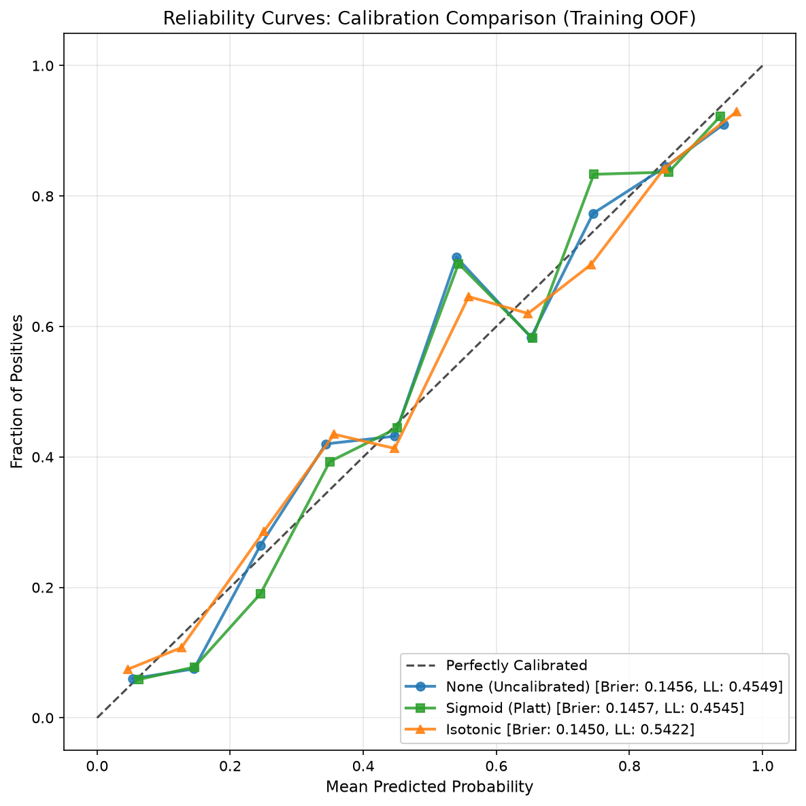

# Calibration Comparison Report (Out-of-Fold Training Set)

Evaluation of three probability calibration options on cross-validated out-of-fold predictions strictly on the training set ($N=736$, 5-fold Stratified CV):

| Method | Calibration Technique | OOF Brier Score | OOF Log Loss | Selected |
| :--- | :--- | :---: | :---: | :---: |
| **none** | Uncalibrated (Natural Sigmoid Link) | 0.1456 | 0.4549 | ✅ Selected |
| **sigmoid** | Platt Scaling (Parametric Logistic) | 0.1457 | 0.4545 | No |
| **isotonic** | Isotonic Regression (Non-parametric Step) | 0.1450 | 0.5422 | No |

### Selection Rule & Rationale

- **Documented Selection Rule:** Prefer simpler method (`none` > `sigmoid` > `isotonic`) unless an alternative demonstrates meaningful calibration improvement ($\Delta\text{Brier} > 0.005$ and $\Delta\text{LogLoss} > 0.010$).
- **Decision:** **none**
- **Rationale:** Evaluated 3 calibration options on out-of-fold training predictions: 'none' (Brier=0.1456, LogLoss=0.4549), 'sigmoid' (Brier=0.1457, LogLoss=0.4545), and 'isotonic' (Brier=0.1450, LogLoss=0.5422). Under the documented parsimony rule requiring ΔBrier > 0.005 and ΔLogLoss > 0.010 to justify post-hoc complexity, uncalibrated Logistic Regression ('none') was chosen. Logistic Regression optimizes the Bernoulli log-likelihood directly and is naturally well-calibrated via its sigmoid link; post-hoc calibration provides no meaningful gain and non-parametric isotonic regression overfits small cohorts.

### Reliability Curve Comparison

